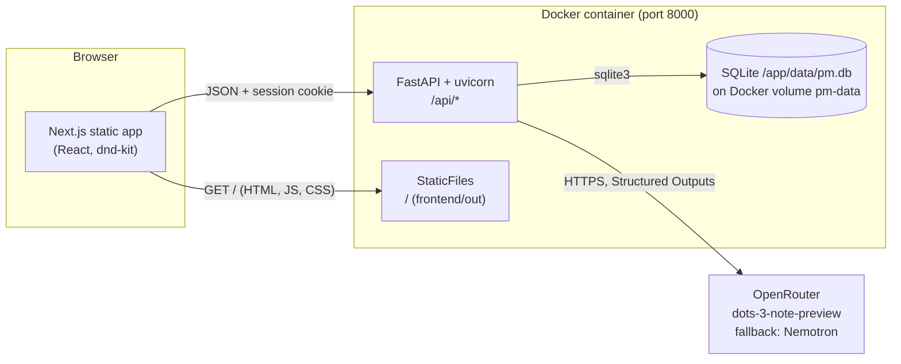
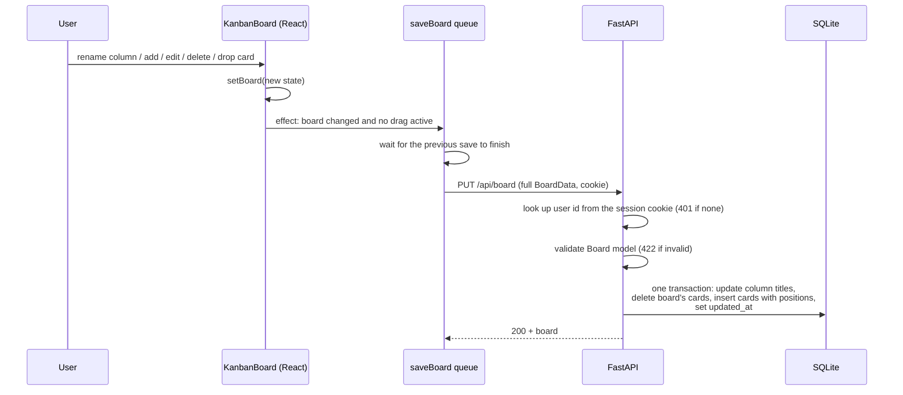
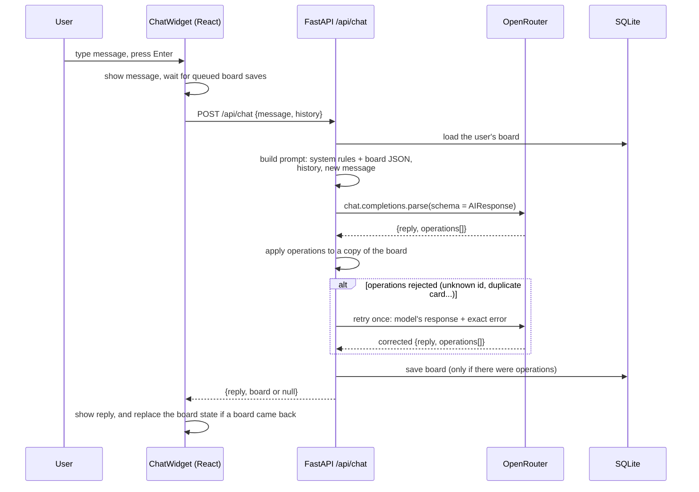
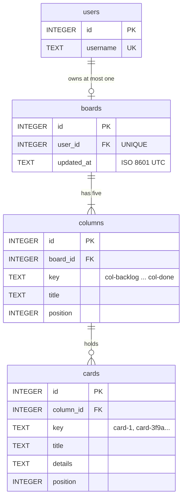

# Kanban Studio: Project Overview

Kanban Studio is a single-board project management app with an AI assistant that can change the board for you. You sign in, manage cards on a five-column Kanban board with drag and drop, and ask the assistant in plain English to create, edit, move or delete cards. Its changes appear on the board straight away.

It is an MVP: one Docker container runs a Next.js frontend (exported as static files), a FastAPI backend, a SQLite database, and calls to a free model on OpenRouter.

This document describes the code as it is on `main` (last commit `0037dcb`, 2026-10-23), plus the security hardening for public deployment (env-based credentials, rate limits, security headers, Render support), not yet committed. Anything not built yet is labelled **Planned**.

## Contents

1. [What the app is](#1-what-the-app-is)
2. [Features](#2-features)
3. [Architecture](#3-architecture)
4. [Tech stack](#4-tech-stack)
5. [Project structure](#5-project-structure)
6. [Data model](#6-data-model)
7. [API reference](#7-api-reference)
8. [AI integration](#8-ai-integration)
9. [Auth and sessions](#9-auth-and-sessions)
10. [Running it](#10-running-it)
11. [Testing](#11-testing)
12. [Known limitations and issues](#12-known-limitations-and-issues)
13. [Deploying to Render](#13-deploying-to-render)
14. [Roadmap](#14-roadmap)

---

## 1. What the app is

### Purpose

A focused Kanban board for one person's project, with an AI assistant built in. The goal of the MVP is to show the full loop working end to end: a typed React UI, a validated Python API, relational storage, and an LLM that changes application data safely through Structured Outputs instead of free text.

### Who it's for

- **Users:** anyone tracking a small project who wants a simple board and the option to manage it by chatting ("move everything in Review to Done").
- **Developers:** a compact, fully tested reference for a Next.js + FastAPI + SQLite app in one container, including a robust pattern for letting an LLM edit structured data.

### The user experience

1. Open http://localhost:8000 and sign in with the username and password you configured (`APP_USERNAME` and the password behind `APP_PASSWORD_HASH`; see [section 10](#10-running-it)).
2. The board loads with five columns: Backlog, Discovery, In Progress, Review and Done. A new user starts with eight example cards.
3. Rename a column by typing over its title. Add, edit and remove cards. Drag cards within and between columns.
4. Every change saves automatically. Reload the page, or restart the container, and the board is still there.
5. Click the purple chat bubble in the bottom right to open the AI assistant. Ask it about the board, or ask it to change cards. When it changes the board, the board updates without a reload.

---

## 2. Features

Everything below is built and covered by tests unless marked otherwise.

| Feature | How it works for the user | Limits |
|---|---|---|
| **Sign in** | A form asks for username and password. Wrong credentials show "Invalid username or password." (the same for a wrong username or a wrong password). After 5 failed attempts from one IP in 15 minutes, it shows "Too many sign-in attempts. Try again in 15 minutes." The session lasts 7 days and survives page reloads. | One account, set by `APP_USERNAME` and `APP_PASSWORD_HASH`. No registration or password reset. |
| **Sign out** | "Log out" in the header returns to the sign-in form. | None. |
| **Board** | Five columns with a card count each. On wide screens the columns share the width. When they don't fit (phones, tablets, ~1280px laptops) the board scrolls sideways; columns are never narrower than 260px. | One board per user. The five columns are fixed: they can be renamed, but not added, removed or reordered. |
| **Rename a column** | Type over the column title. Each keystroke saves. | The AI assistant cannot rename columns. |
| **Create a card** | "Add a card" at the bottom of a column opens a form: title (required) and details (optional). The card is added at the bottom of that column. | If details are left empty, the card is saved with the text "No details yet." |
| **Edit a card** | "Edit" turns the card into an inline form. Save or Cancel. | Dragging is disabled while a card is being edited. |
| **Delete a card** | "Remove" deletes the card immediately. | No confirmation and no undo. |
| **Drag and drop** | Drag a card (after moving the pointer 6px) to reorder it in its column or move it to another one. The target column opens a gap where the card will land. Escape cancels a drag and restores the board. | Pointer only: there is no keyboard dragging. Touch dragging has not been tested. |
| **Persistence** | Every change is sent to the server and stored in SQLite. Saves are queued so they reach the server in order. | If a save fails (for example the session expired), the UI does not tell you. |
| **AI assistant** | A chat bubble in the bottom right opens a panel that floats over the board. Send with Enter (Shift+Enter for a new line). "Thinking..." shows while waiting. The assistant answers questions about the board and can create, edit, move and delete one or more cards in one message. Board changes appear immediately. | 20 messages per user per hour. Messages are capped at 2000 characters, and only the last 20 messages of history are sent. Chat history is kept only in the browser and is lost on refresh. The assistant can't rename columns. It depends on free models that are sometimes wrong or unavailable (see [section 12](#12-known-limitations-and-issues)). |
| **Chat panel state** | The panel starts minimized. Open/minimized is remembered in the browser (`localStorage` key `chat-open`). Minimizing keeps the conversation. | Per browser, not per account. |
| **Chat errors** | If the AI fails (OpenRouter error, daily quota used up, invalid update), the panel shows "The assistant had trouble, try again." and puts your message back in the input. At the hourly limit it shows "You have reached the hourly chat limit. Try again later." Other failures show a generic message. | The board is never partly changed: an invalid AI update changes nothing. |

---

## 3. Architecture

### Overview



### Single container: how the frontend is served

There is no Node server at runtime. The [Dockerfile](../Dockerfile) has two stages:

1. **`node:24-slim`** runs `npm ci` and `npm run build`. [`next.config.ts`](../frontend/next.config.ts) sets `output: "export"`, so the build writes plain HTML, JS and CSS to `frontend/out`.
2. **`python:3.14-slim`** installs the locked Python dependencies with uv, copies the backend, and copies `frontend/out` from the first stage.

At startup, [`main.py`](../backend/app/main.py) registers the `/api/*` routes first, then mounts `StaticFiles(directory=STATIC_DIR, html=True)` at `/`. Requests to `/api/...` hit the API and everything else is served from the export. The browser and API share one origin, so there is no CORS setup, and the session cookie just works.

The app is a single page: [`page.tsx`](../frontend/src/app/page.tsx) asks `/api/me` whether there is a session, then shows either the sign-in form or the board.

### Request flow: saving the board

The board is always saved whole. There are no per-card endpoints.



1. A user action updates the board state in [`KanbanBoard.tsx`](../frontend/src/components/KanbanBoard.tsx).
2. An effect sees that the board differs from the last saved board. It skips the intermediate states while a card is being dragged, so a drag saves once, on drop.
3. `saveBoard` in [`api.ts`](../frontend/src/lib/api.ts) chains the request onto the previous save. Typing a column title sends one save per keystroke, and the server handles requests concurrently, so without the queue an older board could finish last and win.
4. FastAPI reads the username from the signed session cookie and looks up the user id.
5. The body is validated as a `Board` ([`board.py`](../backend/app/board.py)): the five fixed column ids in order, each card stored under its own id, and every card in exactly one column.
6. `db.save_board` rewrites the board in one transaction.

### Request flow: an AI chat message



1. [`ChatWidget.tsx`](../frontend/src/components/ChatWidget.tsx) shows the message and calls `sendChat`. `sendChat` first waits for queued board saves, so the AI sees your latest edits.
2. It posts `{message, history}`. The history is the last 20 earlier messages in this browser session. The backend checks the hourly chat limit (429) and the size caps (422) before calling the AI.
3. The backend loads the board and builds the messages in [`chat.py`](../backend/app/chat.py): a system prompt with the rules and the current board as JSON, then the history, then the new message.
4. [`ai.py`](../backend/app/ai.py) calls OpenRouter with the `AIResponse` schema as a Structured Output. Any failure here (network, quota, timeout, a reply cut off at the token cap, invalid JSON) returns **502** at once.
5. The operations are logged and applied to a copy of the board with `apply_operations`. If they are invalid, the model gets **one retry** with its own response and the exact error. If the retry is also invalid, the response is **502** and nothing changes.
6. If there were operations, the new board is saved and returned. Otherwise `board` is `null`.
7. The widget shows the reply. If a board came back, `KanbanBoard` replaces its state and marks that board as already saved, so it doesn't send it back with a redundant PUT.

---

## 4. Tech stack

Versions are the exact locked versions (`package-lock.json`, `uv.lock`) and Docker image tags.

| Layer | Technology | Version | Why it's used |
|---|---|---|---|
| Frontend framework | Next.js (App Router), static export | 16.1.6 | Modern React tooling; the static export lets FastAPI serve the UI from the same container and origin. |
| UI library | React | 19.2.3 | Component model and state for the board and chat. |
| Language | TypeScript | 5.9.3 | Types shared across the board model, API client and components. |
| Styling | Tailwind CSS (via `@tailwindcss/postcss`) | 4.1.18 | Utility classes with the project colour scheme as CSS variables in `globals.css`. |
| Drag and drop | @dnd-kit/core, /sortable, /utilities | 6.3.1, 10.0.0, 3.2.2 | Accessible, flexible sortable lists with a custom collision strategy and drag overlay. |
| Class helper | clsx | 2.1.1 | Conditional class names. |
| Fonts | `next/font/google` (Space Grotesk, Manrope) | bundled with Next | Downloaded at build time and self-hosted in the export. |
| Backend framework | FastAPI | 0.157.0 | Typed routes, dependency injection for auth, automatic request validation with Pydantic. |
| ASGI server | uvicorn | 0.54.0 | Runs FastAPI. |
| Web toolkit | Starlette (via FastAPI) | 1.9.0 | `SessionMiddleware` and `StaticFiles`. |
| Validation | Pydantic | 2.14.1 | Board model and its consistency rules; the AI response schema. |
| Session signing | itsdangerous | 2.2.0 | Required by Starlette's signed session cookies. |
| Password hashing | argon2-cffi | 25.1.0 | Argon2id hashing and constant-time verification of the sign-in password. |
| Language and runtime | Python | 3.14 (`python:3.14-slim`) | Required by `pyproject.toml` (`>=3.14`). |
| Package manager | uv | 0.11.28 (Docker), lockfile `uv.lock` | Fast, reproducible installs (`uv sync --locked`). |
| Database | SQLite via the standard library `sqlite3` | bundled with Python | Zero setup, one file, relational schema ready for more users. |
| AI client | OpenAI Python SDK, pointed at OpenRouter | 3.37.0 | `chat.completions.parse` turns a Pydantic model into a JSON Schema and parses the reply. Uses `httpx2` for HTTP. |
| AI provider | OpenRouter | n/a | One API for many models, free tier, server-side fallback models. |
| AI models | `dots-studio/dots-3-note-preview:free`, fallback `nvidia/nemotron-3-super-120b-a12b:free` | n/a | Free models that support Structured Outputs. |
| Backend tests | pytest, httpx2 (FastAPI `TestClient`) | 9.1.1, 2.16.0 | API, database and chat tests with a mocked AI. |
| Unit tests | Vitest, Testing Library (React, user-event, jest-dom), jsdom | 3.2.4, 16.3.2, 14.6.1, 6.9.1, 27.0.1 | Component tests in a simulated DOM. |
| End-to-end tests | Playwright (Chromium) | 1.58.0 | Real browser against the real backend, including drag and drop. |
| Linting | ESLint with `eslint-config-next` | 9.39.2, 16.1.6 | Next.js and React rules. |
| Container | Docker, multi-stage | `node:24-slim`, `python:3.14-slim` | One image with the built frontend and the backend. |
| Scripts | POSIX sh and PowerShell | n/a | Start and stop on Mac, Linux and Windows. |

---

## 5. Project structure

```text
pm/
├── AGENTS.md                    Business requirements, technical decisions, colour scheme, coding standards
├── README.md                    Short summary that links here
├── Dockerfile                   Two stages: build the Next.js export, then the Python image that serves it
├── .dockerignore                Keeps .env*, certs/, databases, node_modules, .venv, .git, tests and build/test output out of the image
├── .env.example                 Every environment variable with a placeholder value
├── .env                         Local secrets (gitignored; never in the image)
├── certs/
│   └── .gitkeep                 Extra CA certs are copied here by the start scripts (gitignored, mounted at runtime)
├── scripts/
│   ├── AGENTS.md                How the scripts work
│   ├── start.sh / start.ps1     Copy an extra CA cert if set, build the image, (re)start the container
│   ├── stop.sh / stop.ps1       Remove the container (the data volume is kept)
│   └── hash_password.py         Prompts for a password and prints the argon2 hash for APP_PASSWORD_HASH
├── docs/
│   ├── PLAN.md                  The 10-part build plan with checklists, decisions and status notes
│   ├── DATABASE.md              Schema, row-to-JSON mapping and database lifecycle
│   └── OVERVIEW.md              This document
├── backend/
│   ├── AGENTS.md                Backend notes for developers and coding agents
│   ├── pyproject.toml           Dependencies and pytest settings
│   ├── uv.lock                  Locked Python dependencies
│   ├── app/
│   │   ├── main.py              FastAPI app: session middleware, security headers, rate limits, auth, board and chat routes, static mount
│   │   ├── config.py            Reads and validates the environment; refuses to start without the required variables
│   │   ├── security.py          Password check, client IP, in-memory rate limiter, Content-Security-Policy
│   │   ├── board.py             Pydantic Card / Column / Board models, fixed column ids, DEFAULT_BOARD
│   │   ├── db.py                SQLite schema, init, read and write the board as rows
│   │   ├── chat.py              Chat request, AI response schema, system prompt, apply_operations, retry messages
│   │   └── ai.py                OpenRouter client: model, fallback, token cap, reasoning effort, timeout
│   └── tests/
│       ├── conftest.py          Test credentials, test client with a fresh temporary database per test; logged-in fixture
│       ├── static/index.html    Stand-in for the frontend build (with one inline script for the CSP test)
│       ├── test_main.py         Health, index, login and logout, rate limits, cookies, headers, production mode, startup config checks
│       ├── test_board.py        Board API, validation, persistence, isolation between users
│       ├── test_chat.py         Chat endpoint with a mocked AI, plus live tests
│       └── test_ai.py           Live "What is 2+2?" connectivity test
└── frontend/
    ├── AGENTS.md                Frontend notes for developers and coding agents
    ├── README.md                Minimal run and test commands
    ├── package.json             Scripts and dependencies
    ├── next.config.ts           output: "export"
    ├── playwright.config.ts     One worker; builds and starts the backend on port 8001, or uses BASE_URL
    ├── vitest.config.ts         jsdom, globals, @ alias
    ├── src/
    │   ├── app/
    │   │   ├── layout.tsx       Fonts and page metadata
    │   │   ├── page.tsx         Session check, then the sign-in form or the board
    │   │   └── globals.css      Colour scheme and surface tokens as CSS variables
    │   ├── lib/
    │   │   ├── api.ts           fetch helpers: me, login, logout, getBoard, saveBoard (queued), sendChat
    │   │   └── kanban.ts        BoardData types, moveCard, findColumnId, createId
    │   ├── components/
    │   │   ├── KanbanBoard.tsx  Board state, autosave, drag and drop, header, renders ChatWidget
    │   │   ├── KanbanColumn.tsx Droppable column, editable title, card list, NewCardForm
    │   │   ├── KanbanCard.tsx   Sortable card with inline edit form, Edit / Remove
    │   │   ├── KanbanCardPreview.tsx  The card shown under the pointer while dragging
    │   │   ├── NewCardForm.tsx  Add-a-card form
    │   │   ├── LoginForm.tsx    Sign-in form
    │   │   └── ChatWidget.tsx   Chat bubble and floating panel: history, sending, errors
    │   └── test/
    │       ├── board.ts         defaultBoard fixture, matching the backend's DEFAULT_BOARD
    │       └── setup.ts         jest-dom matchers for Vitest
    └── tests/                   Playwright specs: auth.spec.ts, kanban.spec.ts, chat.spec.ts; credentials.ts
```

---

## 6. Data model

### Tables

The full schema and mapping rules are in [DATABASE.md](DATABASE.md).



| Table | Purpose | Notes |
|---|---|---|
| `users` | One row per account. | No password column: the one account's password hash is in the environment (`APP_PASSWORD_HASH`). The `APP_USERNAME` row is inserted at startup. |
| `boards` | One board per user. | `user_id` is `UNIQUE`; dropping that constraint would allow several boards per user. `updated_at` is set on every save. |
| `columns` | The five columns of a board. | `key` is the id the frontend sees; `(board_id, key)` is unique; `position` orders the columns. |
| `cards` | Cards in columns. | `key` is the frontend id; `position` orders cards within a column. Key uniqueness within a board is enforced by the Pydantic model, not the schema. |

Integer `id`s never leave the backend. The API only uses the string keys. Foreign keys are enforced with `PRAGMA foreign_keys = ON` on every connection. A user's board is created from `DEFAULT_BOARD` on their first board read or write.

### The `BoardData` JSON shape

The API sends and receives the whole board in the same shape the frontend uses ([`kanban.ts`](../frontend/src/lib/kanban.ts), mirrored by `Board` in [`board.py`](../backend/app/board.py)):

```ts
type Card = { id: string; title: string; details: string };
type Column = { id: string; title: string; cardIds: string[] }; // cardIds top to bottom
type BoardData = { columns: Column[]; cards: Record<string, Card> };
```

Example (shortened to three cards):

```json
{
  "columns": [
    { "id": "col-backlog", "title": "Backlog", "cardIds": ["card-1", "card-2"] },
    { "id": "col-discovery", "title": "Discovery", "cardIds": [] },
    { "id": "col-progress", "title": "In Progress", "cardIds": ["card-4"] },
    { "id": "col-review", "title": "Review", "cardIds": [] },
    { "id": "col-done", "title": "Done", "cardIds": [] }
  ],
  "cards": {
    "card-1": { "id": "card-1", "title": "Align roadmap themes", "details": "Draft quarterly themes with impact statements and metrics." },
    "card-2": { "id": "card-2", "title": "Gather customer signals", "details": "Review support tags, sales notes, and churn feedback." },
    "card-4": { "id": "card-4", "title": "Refine status language", "details": "Standardize column labels and tone across the board." }
  }
}
```

Validation rules (enforced on every write, 422 on failure):

- `columns` must be exactly `col-backlog`, `col-discovery`, `col-progress`, `col-review`, `col-done`, in that order.
- Each card must be stored under its own id (`cards["card-1"].id == "card-1"`).
- Every card must be in exactly one column, and every id in `cardIds` must exist in `cards`.

Card ids come from two places: cards added in the UI get `card-` plus a random base-36 string (`createId`), and cards created by the AI get `card-` plus 12 hex characters assigned by the server.

---

## 7. API reference

All endpoints take and return JSON. "Auth" means a valid session cookie from `POST /api/login` is required. Without one the response is `401 {"detail": "Not signed in"}`.

| Method | Path | Auth | Purpose |
|---|---|---|---|
| GET | `/api/health` | No | Liveness check |
| POST | `/api/login` | No | Sign in and set the session cookie |
| POST | `/api/logout` | No | Clear the session |
| GET | `/api/me` | Yes | The signed-in username |
| GET | `/api/board` | Yes | The user's board (created from the default on first use) |
| PUT | `/api/board` | Yes | Replace the user's board |
| POST | `/api/chat` | Yes | Send a message to the AI assistant |
| GET | `/` and other paths | No | The static frontend. Unknown paths, including unknown `/api/...` paths, return 404 with the Next.js HTML 404 page, not JSON. |
| GET | `/docs`, `/redoc`, `/openapi.json` | No | FastAPI's API docs, in development only. With `ENV=production` they return 404. |

Validation errors use FastAPI's standard 422 format: `{"detail": [{"type": ..., "loc": [...], "msg": ..., ...}]}`. Unhandled errors return a plain `500 Internal Server Error` with no stack trace or detail; the traceback goes only to the server log.

Every response carries these security headers:

| Header | Value |
|---|---|
| `Content-Security-Policy` | `default-src 'self'`; `script-src 'self'` plus the SHA-256 hash of each inline script in the Next.js export (computed at startup, so no `'unsafe-inline'` for scripts); `style-src 'self' 'unsafe-inline'`; `img-src 'self' data:`; `font-src 'self'`; `connect-src 'self'`; `object-src 'none'`; `base-uri 'self'`; `form-action 'self'`; `frame-ancestors 'none'`. Left off `/docs` and `/redoc` in development, because Swagger UI loads from a CDN. |
| `X-Content-Type-Options` | `nosniff` |
| `X-Frame-Options` | `DENY` |
| `Referrer-Policy` | `strict-origin-when-cross-origin` |

### `GET /api/health`

```json
200 {"status": "ok"}
```

### `POST /api/login`

```json
// Request
{"username": "alice", "password": "..."}

// 200, with a Set-Cookie: session=... header
{"username": "alice"}
```

| Status | When |
|---|---|
| 401 | `{"detail": "Invalid username or password"}`, for a wrong username or a wrong password alike |
| 429 | `{"detail": "Too many sign-in attempts, try again later"}`: 5 failed attempts from this IP in the last 15 minutes. Checked before the password, so even the right password is refused. |
| 422 | Missing or non-string fields, a username over 100 characters or a password over 200 |

### `POST /api/logout`

Clears the session. Works with or without one.

```json
200 {"status": "ok"}
```

### `GET /api/me`

```json
200 {"username": "alice"}
```

401 without a session. The frontend uses this on load to decide between the sign-in form and the board.

### `GET /api/board`

Returns the user's board as `BoardData` ([section 6](#6-data-model)). On a user's first request, the default board with eight cards is created and returned.

| Status | When |
|---|---|
| 200 | The board |
| 401 | No session |

### `PUT /api/board`

Request body: a full `BoardData`. The response echoes the saved board.

| Status | When |
|---|---|
| 200 | Saved; body is the board |
| 401 | No session |
| 422 | Invalid board: wrong columns, a card in no column or in two columns, a card stored under another id, malformed JSON. Nothing is saved. |

### `POST /api/chat`

```json
// Request
{
  "message": "Move the QA card to Done",
  "history": [
    {"role": "user", "content": "What is in Review?"},
    {"role": "assistant", "content": "Review has one card: QA micro-interactions."}
  ]
}

// 200 when the AI changed the board
{
  "reply": "Moved QA micro-interactions to Done.",
  "board": { "columns": [ ... ], "cards": { ... } }
}

// 200 when nothing changed (a question, or no change requested)
{"reply": "Review has one card: QA micro-interactions.", "board": null}
```

`history` holds earlier messages, oldest first, with `role` either `user` or `assistant`. `message` is the new one. `message` must be 1 to 2000 characters, `history` at most 20 messages, each at most 4000 characters (longer, since assistant replies are in it).

| Status | When |
|---|---|
| 200 | Reply, plus the saved board if it changed |
| 401 | No session |
| 422 | Malformed or oversized request (e.g. a `role` other than `user` / `assistant`, a message over 2000 characters, more than 20 history messages) |
| 429 | `{"detail": "Chat limit reached, try again later"}`: 20 chat requests by this user in the last hour. The AI is not called. |
| 502 | `{"detail": "The AI call failed"}`: OpenRouter error, rate limit or daily quota, timeout, reply cut off at the token cap, or invalid JSON |
| 502 | `{"detail": "The AI returned an invalid update"}`: the operations were invalid on the first try and on the retry. The board is unchanged. The specific error is logged, not returned. |

---

## 8. AI integration

### Models and configuration

All of this is in [`ai.py`](../backend/app/ai.py).

| Setting | Value | Notes |
|---|---|---|
| Endpoint | `https://openrouter.ai/api/v1` | OpenAI-compatible, via the `openai` SDK |
| Primary model | `OPENROUTER_MODEL`, default `dots-studio/dots-3-note-preview:free` | |
| Fallback | `nvidia/nemotron-3-super-120b-a12b:free` | Sent as OpenRouter's `models` list; OpenRouter tries it when the primary fails. |
| Structured Outputs | `chat.completions.parse(response_format=AIResponse)` | The SDK turns the Pydantic model into a strict JSON Schema and parses the reply. |
| Provider routing | `provider.require_parameters: true` | Only route to providers that support every parameter sent, including Structured Outputs. |
| Token cap | `max_tokens` 4000 | Reasoning tokens count towards it. Raised from 2000 after a reply was cut off mid-reasoning. |
| Reasoning effort | `reasoning: {"effort": "low"}` | Both models list `reasoning`. In 8 measured calls it made no clear difference (about 74 reasoning tokens with it, 88 without). |
| Timeout | 60 seconds | The SDK default would wait up to 10 minutes on a hung free provider. |
| Env vars | `OPENROUTER_API_KEY` (required), `OPENROUTER_MODEL` (optional) | Read from the environment; the container gets them from `.env`. |

`openrouter/free` was tried and rejected: it routes to small models that returned invalid updates and once generated 65,536 tokens. Don't use it.

### The Structured Output schema

```python
class CreateCard(BaseModel):
    action: Literal["create"]
    column_id: str
    title: str
    details: str

class UpdateCard(BaseModel):
    action: Literal["update"]
    card_id: str
    title: str
    details: str

class MoveCard(BaseModel):
    action: Literal["move"]
    card_id: str
    column_id: str
    position: int

class DeleteCard(BaseModel):
    action: Literal["delete"]
    card_id: str

class AIResponse(BaseModel):
    reply: str
    operations: list[CreateCard | UpdateCard | MoveCard | DeleteCard]
```

A response from the model looks like this. The keys are in alphabetical order because that is how the provider generates them, which matters for the key-order bug [below](#bugs-found-in-testing-and-their-fixes):

```json
{
  "operations": [
    {"action": "move", "card_id": "card-6", "column_id": "col-done", "position": 0},
    {"action": "update", "card_id": "card-1", "details": "Q3 themes", "title": "Roadmap themes v2"}
  ],
  "reply": "Moved QA micro-interactions to the top of Done and renamed the roadmap card."
}
```

### Operations

| Operation | Effect | Rules |
|---|---|---|
| `create` | Add a card at the bottom of `column_id`. The server assigns the id (`card-` + 12 hex). | The column must exist. The title must not match an existing card's title (case-insensitive). The model must not refer to the new card in another operation, because it doesn't know the id. |
| `update` | Set a card's title and details. | The card must exist. The model repeats the current value of any field it keeps. |
| `move` | Move a card to `column_id` at `position` (0 is the top). | Card and column must exist. |
| `delete` | Remove a card. | The card must exist. |

Operations are applied in order to a copy of the board. The result must also pass the normal `Board` validation. Any failure rejects the whole set, so a response is applied completely or not at all.

### The prompt

The system prompt in [`chat.py`](../backend/app/chat.py) explains the board JSON, says the columns are fixed, describes the four operations, and adds these rules:

- To change a card's column, always use move with the existing card id, never create a copy.
- Use the exact column and card ids from the board.
- Return operations only for the latest message, because earlier ones are already applied to the board shown.
- Never repeat an operation. Return no operations when the user isn't asking for a change.
- Always write a short plain-text reply saying what was done, with no Markdown. The chat panel shows text as-is.

The current board JSON is appended to the system prompt on every request. It is followed by the chat history and then the new message.

### Validation and the self-correction retry

When `apply_operations` rejects the operations, the error message is written for the model, for example:

- `card new-card-1 does not exist. Use a create operation to add a new card, and never refer to a new card in another operation`
- `column col-todo does not exist. The columns are col-backlog, col-discovery, col-progress, col-review, col-done`
- `card "QA micro-interactions" already exists as card-6. To put an existing card in another column, use a move operation with its card_id; never create a copy`

The backend then sends a second request with two extra messages: the model's rejected response, and a user message saying "Your operations were rejected, so nothing was applied: <error>. Return the full corrected list of operations for my previous message." There is at most one retry. If it is also invalid, the endpoint returns 502 and the board is unchanged.

Every attempt's operations are logged at INFO (`AI operations on attempt N: [...]`) and every rejection at WARNING, so `docker logs pm-app` shows exactly what the model returned.

### Bugs found in testing, and their fixes

Each of these was found with evidence from logs or saved data, and each now has a test.

| Problem | Root cause | Fix |
|---|---|---|
| **Renames turned into deletes.** In 7 of 8 calls, "rename card X" came back as a delete, even though the model's reasoning said "Operation: update". | The provider writes Structured Output keys in **alphabetical order**. The discriminator was named `type`, which sorts after `card_id`. Once an operation began with `"card_id"`, the only schema branch that could continue with `"type"` was delete (an update must continue with `"details"`). The key order, not the model, picked the operation. | Renamed the discriminator to `action`, which sorts before every other key, so the model commits to the operation first. Covered by `test_live_rename_card` (live). |
| **"Move all tasks to Done" copied every card.** The originals stayed in their columns and six duplicates appeared in Done. | The model used `create` instead of `move`. Every create was valid under the old rules, so nothing triggered a retry. | A prompt rule (move, never copy), and validation that rejects a create whose title matches an existing card, which triggers the retry. Covered by `test_move_all_cards_to_done_moves_instead_of_copying`. |
| **Operations on cards that don't exist yet** (e.g. a move of `new-card-1`). | The model invented ids for cards it was creating in the same response. | A prompt rule, plus the self-correction retry with the exact error. |
| **Replies cut off.** | The reply hit the 2000-token cap: once as runaway output, once as 2242 reasoning tokens. | Cap raised to 4000, low reasoning effort requested, and any cut-off reply returns a clean 502. |
| **Raw Markdown in the chat** (`**In Progress**`). | The model formatted replies as Markdown, and the panel shows text as-is. | The prompt asks for plain text. |

---

## 9. Auth and sessions

- **Credentials from the environment.** [`config.py`](../backend/app/config.py) reads `APP_USERNAME` and `APP_PASSWORD_HASH` (an argon2id hash, made with `uv run scripts/hash_password.py`). No plain password is stored anywhere. There are no defaults: if `APP_USERNAME`, `APP_PASSWORD_HASH` or `SESSION_SECRET` is missing, the process exits at startup with a message naming them. It also exits if the hash isn't an argon2 hash, `SESSION_SECRET` is under 32 characters, or `ENV` is anything but `development` or `production`.
- **Checking a sign-in.** `credentials_valid` in [`security.py`](../backend/app/security.py) always verifies the password with argon2 (constant time), even when the username is wrong, and compares the username with `hmac.compare_digest`. A wrong username and a wrong password take the same time and get the same 401 message. Usernames over 100 characters and passwords over 200 are rejected with 422 before hashing, so huge inputs can't tie up the CPU.
- **Sign-in rate limit.** 5 failed attempts per client IP per 15 minutes, then 429 until the oldest failure is 15 minutes old. Successful sign-ins don't count. The client IP is the socket address locally. In production it is the **last** `X-Forwarded-For` entry: Render's proxy appends the address it received the request from and keeps whatever the client sent before it, so only the last entry can't be forged. Locally there is no proxy, so the header is ignored.
- **Signed cookie sessions.** On success the session is cleared, then Starlette's `SessionMiddleware` stores the username in a cookie named `session`, signed with `SESSION_SECRET` using itsdangerous, so it can't be forged (its contents are only base64-encoded, not encrypted). Attributes: `HttpOnly`, `SameSite=Lax`, path `/`, 7 days, and `Secure` when `ENV=production`. Locally the app is plain HTTP, so `Secure` is off there.
- **Route protection.** The `current_user` dependency reads the username from the session (401 if absent), and `current_user_id` looks up `users.id`. Every board and chat query is scoped to that id, so the data layer is already multi-user.
- **Chat rate limit.** 20 `/api/chat` requests per user per hour (each one or two AI calls), then 429, checked before the AI is called. Keyed by user id rather than by cookie, so signing in again doesn't reset it.
- **Rate limiter.** Both limits use an in-memory sliding window (`RateLimiter` in `security.py`). It resets when the process restarts and isn't shared between instances, which suits Render's free tier (one instance).
- **Logout** clears the session in the browser. Sessions are signed cookies, not server-side records, so a copied cookie stays valid until it expires (7 days) or `SESSION_SECRET` changes. Changing the secret signs everyone out.
- **The user row** for `APP_USERNAME` is inserted at startup with `INSERT OR IGNORE`. The `users` table has no password column; the one password lives in the environment.
- **Frontend.** On load, `page.tsx` calls `/api/me`, then shows the sign-in form (401) or loads the board.

**Planned** (per [AGENTS.md](../AGENTS.md), beyond the MVP): real multi-user sign-in. The database already supports several users, each with their own board (tested in `test_boards_are_isolated_per_user`). Registration, per-user password storage and server-side session revocation are not built.

---

## 10. Running it

### Prerequisites

- **Docker** (Docker Desktop on Windows and Mac). It must be running before you start the app.
- **An OpenRouter API key** for the AI assistant. The board works without one, but chat requests fail with 502.
- For development and tests only: **Node.js** (the image uses 24), **uv**, and **Python 3.14** (uv can install it).

### Environment variables

Copy [`.env.example`](../.env.example) to `.env` in the project root (gitignored, and excluded from the Docker build) and fill it in. The start scripts pass it to the container with `--env-file`.

| Name | Required | Default | Purpose |
|---|---|---|---|
| `APP_USERNAME` | Yes | none | The sign-in username |
| `APP_PASSWORD_HASH` | Yes | none | Argon2 hash of the sign-in password. Generate with `uv run scripts/hash_password.py`. |
| `SESSION_SECRET` | Yes | none | Signs the session cookie. At least 32 characters; generate with `python -c "import secrets; print(secrets.token_urlsafe(32))"`. |
| `ENV` | No | `development` | `production` turns on `Secure` cookies, hides `/docs`, `/redoc` and `/openapi.json`, and takes the client IP from `X-Forwarded-For` |
| `OPENROUTER_API_KEY` | For AI | none | OpenRouter API key. Without it the board works but chat returns 502. |
| `OPENROUTER_MODEL` | No | `dots-studio/dots-3-note-preview:free` | Primary model |
| `PORT` | No | `8000` | Port uvicorn listens on inside the container (Render sets it) |
| `DATABASE_PATH` | No | `data/pm.db` in the project root (`/app/data/pm.db` in the container) | SQLite file location |
| `STATIC_DIR` | No | `frontend/out` | Where the static frontend is served from |

The app refuses to start without the three required variables. If the page doesn't load, `docker logs pm-app` shows which one is missing or invalid.

**Write the hash unquoted in `.env`.** Docker's `--env-file` reads values literally, so quotes would become part of the value, and the startup check rejects that. `uv run --env-file` (development without Docker) does the opposite: it expands the `$` signs in an unquoted hash. See [Development without Docker](#development-without-docker).

### Start and stop

| | Windows (PowerShell) | Mac / Linux |
|---|---|---|
| Start | `powershell -ExecutionPolicy Bypass -File scripts\start.ps1` | `./scripts/start.sh` |
| Stop | `powershell -ExecutionPolicy Bypass -File scripts\stop.ps1` | `./scripts/stop.sh` |

**Start** builds the `pm-app` image, replaces any running `pm-app` container, and runs it with:

```bash
docker run -d --name pm-app --env-file .env -p 8000:8000 -v pm-data:/app/data \
  -v "$PWD/certs:/app/certs:ro" pm-app
```

Open **http://localhost:8000** and sign in with your `APP_USERNAME` and password.

- **Port:** 8000 (the container runs `uvicorn app.main:app --host 0.0.0.0 --port ${PORT:-8000}`).
- **Data:** the SQLite file lives on the named volume `pm-data`, so the board survives restarts and rebuilds. `stop` removes the container but keeps the volume. To reset the board, run `docker volume rm pm-data` while the container is stopped.
- **After a reboot:** start Docker Desktop first, then `docker start pm-app`. `start` also works, but it rebuilds the image.
- **Logs:** `docker logs -f pm-app` shows requests, plus every AI operation and rejection.

### Development without Docker

```bash
cd frontend && npm install && npm run build       # writes frontend/out
cd ../backend && uv sync
export APP_PASSWORD_HASH='<your hash>'           # single quotes keep the $ signs
uv run --env-file ../.env uvicorn app.main:app --reload   # http://localhost:8000
```

`uv run --env-file` expands `$...` in unquoted values, which mangles the argon2 hash in `.env` (the app then refuses to start). A variable already set in the shell takes precedence over the file, so export the hash in single quotes as above (PowerShell: `$env:APP_PASSWORD_HASH = '<your hash>'`).

`npm run dev` starts the Next.js dev server on its own, but it has no backend, so sign-in doesn't work there.

### Optional: extra CA certificate (Norton and similar)

Some antivirus products (Norton here) scan HTTPS by re-signing traffic with their own root certificate. The host trusts that root, but the container doesn't, so calls from the container to OpenRouter can fail with `CERTIFICATE_VERIFY_FAILED`. Norton's exclusion list did not reliably prevent this.

How the fix works:

1. Norton sets the `NODE_EXTRA_CA_CERTS` environment variable on the host to its root certificate. If that variable points to a file, the start scripts copy it to `certs/extra-ca.pem`, which is gitignored.
2. The start scripts mount `certs/` read-only at `/app/certs`. It is never built into the image (`.dockerignore` excludes it).
3. At container start, the `CMD` writes `/tmp/ca-bundle.pem` from the system CAs (`/etc/ssl/certs/ca-certificates.crt`) plus any `/app/certs/*.pem`, and `SSL_CERT_FILE` points to it. The HTTP client the `openai` SDK uses (`httpx2`) honours `SSL_CERT_FILE`.
4. With no extra cert (or no mount, as on Render), the bundle is just the system CAs, so nothing changes on other machines.

Verified in the container: a Norton-re-signed host returned 200 with the bundle and failed `CERTIFICATE_VERIFY_FAILED` without it. Separately, the Docker build itself needs `registry.npmjs.org` and `fonts.googleapis.com` excluded from HTTPS scanning, or `npm ci` and the font download fail.

---

## 11. Testing

### Summary

Pass counts are from 2026-10-26 on Windows, without an API key in the shell.

| Suite | Tool | Count | What it covers |
|---|---|---|---|
| Backend | pytest | 51 passed, 3 live skipped | Health and static index; login, logout and `/api/me`; identical errors for wrong username and wrong password; cookie attributes; sign-in rate limit (including spoofed `X-Forwarded-For` in production); security headers and the CSP script hash; 500s without details; docs and `Secure` cookies in production mode; refusing to start without required or with invalid config (5 cases); chat rate limit and 4 oversized-request cases; board API auth, default board, save and read, persistence across a restart, 6 invalid-board cases, isolation between users; chat endpoint with a mocked AI: prompt contents, reply-only, all four operations, 6 invalid-operation cases rejected twice, correction on retry, the "move all to Done" copy bug, AI failures (cut-off, connection error, invalid JSON) returning 502 |
| Frontend unit | Vitest + Testing Library | 23 passed | `moveCard` (reorder, move between columns, drop at end); `page.tsx` session and login flow, including the rate-limit message; `sendChat` sends only the last 20 history messages; `KanbanBoard` rename, add, remove, edit, cancel, and showing an AI board without re-saving it; `ChatWidget` starts minimized and remembers, keeps the conversation while minimized, message and reply, history sent, loading state, `onBoardUpdate`, 502, 429 and other error messages |
| End to end | Playwright (Chromium) | 14 passed | Sign in, reload, sign out, wrong credentials; load the board, add, edit, delete, rename, drag between columns, three drop-position cases, Escape cancels a drag, every change survives a reload; chat with `/api/chat` mocked: reply shown, board updated, request body checked |

### Running the tests

```bash
# Backend (from backend/)
uv run pytest                          # mocked tests; live tests skipped
uv run --env-file ../.env pytest       # also runs the live OpenRouter tests

# Frontend unit (from frontend/)
npm run test:unit

# End to end (from frontend/)
npm run test:e2e                                  # builds the frontend, starts uvicorn on 127.0.0.1:8001
BASE_URL=http://localhost:8000 E2E_USERNAME=... E2E_PASSWORD=... npm run test:e2e   # against the running container, with its credentials

# Lint
npm run lint
```

### Live versus mocked tests

- **Mocked** tests replace `ai.parse` with a fake that returns scripted responses or raises scripted errors. They are fast, free and deterministic, and they cover the retry and error paths.
- **Live** tests call OpenRouter and are skipped unless `OPENROUTER_API_KEY` is set:
  - `test_live_two_plus_two`: connectivity.
  - `test_live_add_card`: "add a card called X to Backlog" ends with X saved in Backlog.
  - `test_live_rename_card`: a rename ends with the new title. This guards the key-order fix.

  Live tests depend on a free model, so they can fail for reasons outside the code. They also use the daily request quota.

### Playwright notes

- By default Playwright runs `npm run build`, then starts uvicorn on port 8001 with a temporary database (`pm-e2e.db` in the OS temp directory) and test-only credentials (`test-user` / `test-password`; the hash is in `playwright.config.ts`). It reuses a server already running on 8001, so stop any leftover dev server first.
- With `BASE_URL`, the tests run against that server instead, signing in with `E2E_USERNAME` and `E2E_PASSWORD`, and **they reset that user's board to the default**. The wrong-credentials test counts as one failed sign-in towards the rate limit (5 per 15 minutes).
- Backend tests use their own credentials too (`test-user` / `test-password`, hashed in `conftest.py`), and reset both rate limiters for each test.
- `workers: 1` is required. Every spec signs in as the same user and resets that user's single board, so parallel specs overwrite each other. Parallel runs on Windows also triggered stalled page loads (see [section 12](#12-known-limitations-and-issues)).
- The `/api/chat` route is mocked in the e2e chat test, so it never uses the AI quota.

---

## 12. Known limitations and issues

### AI

- **Free model reliability.** The free models sometimes return wrong operations (creating copies instead of moving, operating on ids that don't exist), run on until the token cap, or are unavailable. The prompt rules, validation, single retry and atomic apply keep the board consistent, but some requests still end in "The assistant had trouble, try again."
- **Daily quota.** The OpenRouter free tier allows 50 free-model requests per day (1000 with $10 of credits). Each chat message uses one or two requests (two when the retry runs). When the quota is used up, every chat request returns 502 until it resets.
- **Fallback availability.** The Nemotron fallback's only free provider was down (404) for much of development, so in practice dots often has no working fallback.
- **The retry can't fix everything.** It runs once. A model that repeats the same mistake ends in 502.
- **Duplicate titles.** Because of the copy-protection rule, the AI can't create a card with the same title as an existing card, even when you ask it to. The UI doesn't have this rule.
- **No column renaming by the AI.** The prompt says columns are fixed, and there is no operation for it.
- **Plain text only.** The panel shows text as-is. If a model ignores the plain-text rule, Markdown symbols appear.

### Data and sessions

- **Chat history lives in the browser only.** It is lost on refresh and not shared across devices (a deliberate MVP decision). Only the last 20 messages are sent, so the assistant forgets older parts of a long conversation.
- **Single user.** One account from the environment. Sessions can't be revoked server-side before they expire, except by changing `SESSION_SECRET`, which signs everyone out.
- **Rate limits are in memory.** They reset when the process restarts (on Render's free tier, after every spin-down). That still caps sign-in guessing at 5 per IP per 15 minutes while the service is up, and argon2 makes each guess slow.
- **Whole-board writes, last write wins.** If you edit the board while an AI request is in progress, the AI's board (based on the board when you sent the message) replaces your newer edits.
- **Silent save failures.** `saveBoard` ignores errors and `getBoard` doesn't check the status, so an expired session or a server error isn't shown to the user.

### UI

- **Drag and drop is pointer only.** No keyboard sensor is configured. Touch dragging on phones hasn't been tested.
- **The chat bubble overlaps the board** in the bottom right. The page has extra bottom padding so the last cards can scroll clear of it.
- **No delete confirmation or undo.**

### Development environment

- **Playwright on Windows.** Running specs in parallel caused stalled page loads and "socket hang up" errors. Two causes were found. First, the specs share one user's board. Second, Python's asyncio proactor event loop on Windows closes the server's listening socket after a client aborts a connection (WinError 64), which was reproduced in the server log. With the selector event loop, some dropped connections still remained, and an earlier part of the plan suspected Norton's traffic inspection. `workers: 1` avoids all of this and is fast enough (about 30 seconds). The Linux container is not affected by the asyncio bug.
- **TypeScript check on test files.** `npx tsc --noEmit` reports "Cannot find name 'expect'" and similar errors in test files, because the Vitest global types aren't picked up by the main `tsconfig.json`. `next build`, Vitest and ESLint all pass.
- **Norton and the Docker build.** See [Optional: extra CA certificate](#optional-extra-ca-certificate-norton-and-similar).
- **The build needs network access** to npm and Google Fonts (`next/font` downloads fonts at build time).

---

## 13. Deploying to Render

The app is one container, so it can run on any Docker host. These are notes for **Render's free tier** (checked against Render's documentation in October 2026). There is no deployment config in the repo; everything is set in the Render dashboard.

### What keeps secrets out

- `.env*` (except `.env.example`), `certs/`, databases, `node_modules`, `.venv` and test output are gitignored, and the git history (all 14 commits, plus unreachable local objects) was scanned on 2026-10-26 with no keys, `.env` files or certificates found.
- `.dockerignore` excludes `.env*`, `certs/`, `*.db`, `.git`, `node_modules`, `.venv`, `__pycache__`, test output and `backend/tests`. The built image was inspected on 2026-10-26: no `.env` files, no `/app/certs`, no extra certificates, and no secrets in the image config or layer history.
- Secrets reach the app only as environment variables set in the Render dashboard.

### Steps

1. Generate the secrets locally:
   ```bash
   uv run scripts/hash_password.py                                 # prints APP_PASSWORD_HASH
   python -c "import secrets; print(secrets.token_urlsafe(32))"    # prints SESSION_SECRET
   ```
2. Push the repo to GitHub.
3. In Render, create a **Web Service** from the repo with the **Docker** runtime and the **Free** instance type. Render builds the root `Dockerfile`.
4. Set environment variables in the Render dashboard (paste the hash as is, without quotes):

   | Name | Value |
   |---|---|
   | `ENV` | `production` |
   | `APP_USERNAME` | Your username |
   | `APP_PASSWORD_HASH` | Output of `hash_password.py` |
   | `SESSION_SECRET` | Output of `token_urlsafe(32)` |
   | `OPENROUTER_API_KEY` | Your OpenRouter key |
   | `OPENROUTER_MODEL` | Optional; defaults to `dots-studio/dots-3-note-preview:free` |

   Don't set `PORT`: Render sets it, and the container listens on it.
5. Set the **health check path** to `/api/health`.
6. After the first deploy, check:
   - The deploy log shows `Uvicorn running`, not `Missing required environment variables`.
   - `https://<service>.onrender.com/docs` returns 404, and the `session` cookie is `Secure` (browser dev tools).
   - **The sign-in rate limit is per client.** Fail to sign in 6 times from your computer, then sign in from a different network (for example a phone on mobile data). The phone should get in. If it is also blocked, Render added another proxy hop, and the last `X-Forwarded-For` entry is a shared proxy address rather than the client. Rate limiting then still works but is shared between users, and `client_ip` in `security.py` needs the second-to-last entry. Render doesn't document its proxy chain, so this is the one assumption to confirm.

### What to expect on the free tier

- **Ephemeral storage.** Free web services can't attach persistent disks, and the local filesystem is wiped on every deploy, restart and spin-down. The SQLite file is recreated at startup, so **the board resets to the default eight cards** whenever that happens. This is fine for a demo, not for real use.
- **Spin-down.** After 15 minutes without traffic the service stops, and the next request takes about a minute to start it again. A spin-down also wipes the data and resets the rate limits. Sessions survive it, because they live in the signed cookie.
- **Hours.** 750 free instance hours per workspace per month. Spun-down time doesn't count.
- **One instance.** That suits SQLite, which shouldn't be shared between instances anyway.

### For persistent data

- A paid Render instance with a **persistent disk** mounted at `/app/data` keeps the SQLite file. `DATABASE_PATH` can point anywhere on the disk.
- Or move to a hosted database. That needs code changes, because `db.py` uses `sqlite3` directly.

---

## 14. Roadmap

### Status of the build plan

The project followed a ten-part plan in [PLAN.md](PLAN.md):

| Part | Topic | Status |
|---|---|---|
| 1 | Plan | Complete |
| 2 | Scaffolding: Docker, FastAPI, scripts | Complete |
| 3 | Static Next.js frontend served by FastAPI, card editing | Complete |
| 4 | Sign in and sign out | Complete |
| 5 | Database modelling | Complete |
| 6 | Backend board API on SQLite | Complete |
| 7 | Frontend connected to the backend | Complete |
| 8 | OpenRouter connectivity | Complete |
| 9 | AI updates the board with Structured Outputs | Complete |
| 10 | AI chat in the UI | Built and committed; marked "awaiting user review" in the plan |

### Remaining in the plan

- **Sign off Part 10.** The chat changed from a sidebar to a floating widget during review. The live checks still to run: `test_live_rename_card` (the key-order fix), and "move all tasks to Done" in the UI (the copy-protection rule).

### Planned beyond the MVP

From the limitations in [AGENTS.md](../AGENTS.md), where the MVP deliberately stops short. None of this is built:

- **Planned:** multiple users with real sign-in. The database is ready (per-user boards are already isolated). Registration and per-user password storage are not built.
- **Planned:** more than one board per user. This needs the `UNIQUE` constraint on `boards.user_id` dropped, plus API and UI changes.

Hosting beyond a local Docker container, originally out of scope for the MVP, is now prepared for Render (see [section 13](#13-deploying-to-render)).

### Suggested next steps

These are suggestions from this review. They are not in the plan.

1. Show save failures and expired sessions in the UI instead of failing silently.
2. Add a keyboard sensor for drag and drop, and test touch dragging.
3. Validate `move` positions: today any integer is accepted and passed to Python's `list.insert`, so a negative position counts from the end and a too-large one appends.
4. Use a persistent disk or hosted database for any real deployment.
5. Let the AI rename columns, since users can.
6. Run the container as a non-root user. Not done yet because the existing `pm-data` volume is owned by root, so local data would need migrating.
